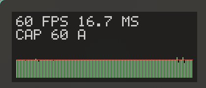

# framepace

framepace is a Vulkan implicit layer for Linux that does three things:

- **A frame limiter** whose cap changes at runtime, with no config reload.
- **A small in-game overlay** (fps, frame time, current cap, frame-time graph) drawn
  into the presented image, so the compositor can still direct-scan-out the game.
- **An adaptive cap daemon** (`fps-cap`) that keeps the cap just below what the game can
  sustain, so frames are paced evenly on a variable-refresh (VRR) display.



Full window: [docs/overlay.png](docs/overlay.png)

It is meant for Linux gamers on VRR (G-Sync / FreeSync) monitors who play through
Proton/Wine with DXVK or vkd3d-proton, or native Vulkan games, and who want a stable
frame cadence rather than the highest possible fps.

> **Anti-cheat notice.** framepace loads into the game process, like MangoHud or
> vkBasalt do. There are no known bans for Vulkan layers of this kind, but nobody can
> promise that. Games with kernel-level anti-cheat may refuse to run with it or flag it.
> Use it at your own risk, and opt a game out with `DISABLE_FRAMEPACE=1` (see
> [Activation](#activation)) if you have any doubt. This project is not affiliated
> with any game or anti-cheat vendor.

## Contents

- [Why it exists](#why-it-exists)
- [Install](#install) / [Uninstall](#uninstall)
- [Using it](#using-it) (CLI, hotkeys, configuration)
- [How it works](#how-it-works)
- [Troubleshooting](#troubleshooting)
- [Compatibility and limitations](#compatibility-and-limitations)
- [Credits](#credits)

## Why it exists

These are the concrete problems framepace was built to fix, found while tuning World of
Warcraft (Proton, vkd3d-proton, NVIDIA, 144 Hz VRR):

- **In-game limiters wake imprecisely under Wine.** The game's own limiter jittered by
  about 0.8 ms frame to frame at a 60 fps cap. framepace's early limiter (deadline grid,
  `clock_nanosleep` followed by a short spin) gets about 0.08 ms.
- **Presenting before the GPU is done makes frames late by a variable amount.** If a
  limiter releases the present at the deadline but the GPU finishes the frame later, the
  frame reaches the display at deadline + GPU time, and that time varies. Measured at the
  display at cap 60, intervals ranged 12.5-19.8 ms even though the limiter's own log was a
  perfect 16.667 ms. framepace first waits for the GPU (a fence on its own relay
  submission), then presents on the deadline. This matches what MangoHud's `early` method
  achieves (about 0.3 ms between present and flip).
- **Changing MangoHud's cap at runtime means reloading its config**, which crashed games
  on NVIDIA (a double free, see MangoHud issue #2078). framepace's cap is one integer in a
  shared memory file, read with a relaxed atomic load each frame. There is no reload.
- **A fixed cap is a bad compromise.** Set it low and you waste headroom in light
  scenes; set it high and busy scenes (crowds, effects) hitch. The adaptive daemon follows
  the slow tail of the per-frame work time instead.
- **"The graph looks flat but the motion hitches."** A frame-time graph normally shows
  *present time*, when the game handed the frame over. What you see is *display time*,
  when the frame reached the screen. If the GPU is still working when the present is
  released, the two differ by a variable amount, and a flat graph hides real judder.
  Headroom matters: the cap must sit where nearly every frame is already finished before
  its deadline. framepace reports `work_ns` (CPU plus GPU time per frame) so the daemon
  can measure that headroom.

## Install

### One-liner

```sh
curl -fsSL https://raw.githubusercontent.com/Kuret/framepace/main/install.sh | sh
```

Read it first if you like: [install.sh](install.sh). Preview everything it would do:

```sh
curl -fsSL https://raw.githubusercontent.com/Kuret/framepace/main/install.sh | sh -s -- --dry-run
```

The installer (POSIX sh, safe to run repeatedly):

1. Installs build dependencies with `sudo`, using pacman (Arch, CachyOS, Manjaro,
   EndeavourOS), apt (Debian, Ubuntu, Pop!_OS, Mint), dnf (Fedora, Nobara) or zypper
   (openSUSE): git, meson, ninja, a C compiler, Vulkan headers, glslang
   (`glslangValidator`) and python3. On other distributions it prints the list and
   carries on if everything is already present.
2. Clones (or updates) the repository into `~/.local/share/framepace/src`.
3. Builds, then `sudo meson install`: the layer goes to
   `/usr/lib/framepace/libVkLayer_framepace.so` and the manifest to
   `/usr/share/vulkan/implicit_layer.d/framepace.x86_64.json`.
4. Installs `fps-cap` into `~/.local/bin` (it warns if that is not on your `PATH`).
5. Writes `~/.config/environment.d/90-framepace.conf` containing `FRAMEPACE=1`.
6. Installs and starts the `framepace.service` systemd user unit (`fps-cap daemon`).
7. Writes `~/.config/framepace/config` if it does not exist yet.

Options: `--dry-run`, `--no-deps`, `--no-service`, `--no-env`, `--prefix DIR`
(testing only; the loader finds manifests under `/usr`). Environment:
`FRAMEPACE_SRC=<path>` uses a local checkout, `FRAMEPACE_REF=<branch|tag>` picks what to
clone.

After installing, **log out and back in once** so `FRAMEPACE=1` reaches your session.
Without systemd's `environment.d` (other init systems, some display managers), set it
yourself: in `~/.profile`, in your compositor's environment config, or per game in the
Steam launch options:

```
FRAMEPACE=1 %command%
```

If you already start an `fps-cap daemon` from a compositor autostart, remove that line;
only one daemon runs at a time.

### From source

```sh
meson setup build
ninja -C build
sudo meson install -C build
install -Dm755 tools/fps-cap ~/.local/bin/fps-cap
```

Build dependencies: meson, ninja, a C11 compiler, Vulkan headers (`vulkan/vk_layer.h`),
`glslangValidator`. To try the layer without installing:

```sh
VK_ADD_IMPLICIT_LAYER_PATH=$PWD/build/dev FRAMEPACE=1 FRAMEPACE_FORCE=1 FRAMEPACE_DEBUG=1 vkcube --wsi wayland
```

### Uninstall

```sh
curl -fsSL https://raw.githubusercontent.com/Kuret/framepace/main/uninstall.sh | sh
```

or `./uninstall.sh`. It removes the layer and manifest (with `sudo`), the user unit, the
environment file, `fps-cap` and the cached source and build. Your
`~/.config/framepace/config` is kept unless you pass `--purge`, which also removes the
state file. Also supports `--dry-run` and `--prefix DIR`. Log out and in again afterwards.

## Using it

Start a game normally. The overlay appears at the top left, and the cap is adaptive by
default once the daemon runs. `fps-cap` controls everything:

| Command | Effect |
|---|---|
| `fps-cap up [n]` / `down [n]` | Raise/lower the cap by `n` (default 1); switches to manual mode. |
| `fps-cap set N` | Set the cap; switches to manual mode. |
| `fps-cap off` | No cap from framepace (overlay only); manual mode. |
| `fps-cap adaptive [on\|off\|toggle]` | Let the daemon manage the cap. |
| `fps-cap overlay [on\|off\|toggle]` | Show or hide the overlay. |
| `fps-cap status` | Mode, cap, overlay, frame counter, writer pid and limits. |
| `fps-cap daemon` | The adaptive controller (run by `framepace.service`). |
| `fps-cap --help` | Usage. |

Caps are clamped to `MIN_CAP`..`MAX_CAP`. The overlay line 2 shows `CAP 90 A` in adaptive
mode, `CAP 90 M` in manual mode, and `CAP OFF` when uncapped.

### Hotkeys

Bind keys to the commands above.

Hyprland (`hyprland.conf`):

```
bind = , F9,  exec, fps-cap down
bind = , F10, exec, fps-cap up
bind = , F11, exec, fps-cap adaptive toggle
bind = , F12, exec, fps-cap overlay toggle
```

Sway (`config`):

```
bindsym F9 exec fps-cap down
bindsym F10 exec fps-cap up
bindsym F11 exec fps-cap adaptive toggle
bindsym F12 exec fps-cap overlay toggle
```

KDE: System Settings, Shortcuts, "Add Command". GNOME: Settings, Keyboard, Custom
Shortcuts. Use `~/.local/bin/fps-cap` as the full path if your desktop does not see it.

### Configuration

`~/.config/framepace/config`, `key = value` lines, `#` comments. All keys are optional:

| Key | Default | Meaning |
|---|---|---|
| `MIN_CAP` | `50` | Lowest cap fps-cap will set. Set it to just above your monitor's VRR floor (frames collide right at the floor). |
| `MAX_CAP` | `0` | Highest cap. `0` = auto: `refresh - refresh^2/3600` (144 Hz gives 138, 60 Hz gives 59), using the fastest connected output from `hyprctl monitors -j`, else `wlr-randr`, else `xrandr`, else 138. |
| `MARGIN` | `1.05` | Adaptive cap = `1000 / (tail work time in ms * MARGIN)`. |
| `PAUSE_WHEN_NOT_FULLSCREEN` | `yes` | Hyprland only: pause adapting while the active window is not fullscreen. Ignored when `hyprctl` or the Hyprland environment is unavailable. |

The daemon reads the config at start; restart it after editing
(`systemctl --user restart framepace.service`). `fps-cap` commands read it every time.

## How it works

### Activation

`FRAMEPACE=1` makes the Vulkan loader load the layer into every Vulkan app, which is why
it is safe to set it globally: the layer then decides, once per process, whether to do
anything. It is **active** when any of these is set (non-empty; Steam ids must not be
`0`): `SteamGameId`, `SteamAppId`, `STEAM_COMPAT_APP_ID`, `STEAM_COMPAT_DATA_PATH`,
`WINEPREFIX`, `WINELOADERNOEXEC`, `WINEDEBUG`, `UMU_ID`, or when the executable is a Wine
loader (`wine`, `wine64`, `wine-preloader`, `wine64-preloader`). Proton, Wine, Lutris,
umu, Heroic, Bottles and Faugus all export at least one of these. Native games that are
not launched through Steam need `FRAMEPACE_FORCE=1`.

It is **never** active in `gamescope`, `gamescopereaper`, `steamwebhelper` or `steam`
(matched on `/proc/self/comm` and the executable name), nor in names listed in
`FRAMEPACE_DENY` (comma-separated). This avoids double limiting inside gamescope and
touching launchers. The deny list wins over `FRAMEPACE_FORCE`.

| Variable | Effect |
|---|---|
| `FRAMEPACE=1` | The loader loads the layer (set by the installer). |
| `DISABLE_FRAMEPACE=1` | The loader does not load the layer (per-game opt-out, e.g. in Steam launch options). |
| `FRAMEPACE_FORCE=1` | Treat this process as a game. |
| `FRAMEPACE_DENY=a,b` | Extra process names that are never active. |
| `FRAMEPACE_DEBUG=1` | Log to stderr, including why the layer is active or not. |

`FRAMEPACE=0` does not load the layer either, but only because the manifest enables it on
`"1"`; the layer itself also treats `0` as off.

An inactive process pays nothing: the layer does not hook `vkQueuePresentKHR` or any
swapchain function, returns the next layer's function pointers directly, and never opens
the state file. If the state file cannot be opened in an active process, the layer is also
a pure passthrough. Any failure while setting up the overlay disables the overlay for that
swapchain only; presenting continues.

### The layer

Standard implicit-layer plumbing (`vkNegotiateLoaderLayerInterfaceVersion`, chain-info
walking in `vkCreateInstance`/`vkCreateDevice`, per-instance and per-device dispatch
tables). It does not link libvulkan. The manifest uses an absolute `library_path` in
`/usr/share/vulkan/implicit_layer.d`, the same layout as MangoHud's, so Steam's
pressure-vessel container imports it and remaps the host library path.

### The limiter

Behaves like MangoHud's `fps_limit_method=early`, run inside `vkQueuePresentKHR` when
`cap > 0`:

1. The deadline advances by `1e9 / cap` per frame (a fixed grid, so jitter in one frame
   does not shift the next).
2. If the frame is already more than one interval past the deadline, the grid resyncs to
   now.
3. Otherwise sleep with `clock_nanosleep(CLOCK_MONOTONIC, TIMER_ABSTIME)` until
   `deadline - 300 us`, then spin (`_mm_pause`, with an occasional `sched_yield`) up to
   the deadline.
4. When the cap changes, the grid restarts from the last present time, so the schedule
   continues without a jump. The new cap applies from the next frame.

With `cap <= 0` there is no wait at all.

### The relay submit and fence wait

Before sleeping, the layer submits an extra batch on the present queue. It waits on the
app's present semaphores, contains the overlay's command buffer when the overlay is on
(otherwise nothing), and signals a per-swapchain-image semaphore and fence. The CPU waits
on that fence (100 ms timeout, then carries on): that is the "frame is rendered" point.
Only then does the limiter sleep or spin to the deadline, and the present goes out waiting
on the already-signalled relay semaphore. Frames therefore reach the display finished.
With `cap <= 0` there is no CPU wait; a relay submit is made only to draw the overlay.

Consequence: while limiting, the presenting thread blocks on the GPU each frame, so the
CPU can no longer run ahead of the GPU. That is deliberate (it is what makes the cadence
even), but it costs a little throughput close to the limit.

### The overlay

Drawn into the swapchain image that is about to be presented, so direct scanout keeps
working. The layer adds `VK_IMAGE_USAGE_COLOR_ATTACHMENT_BIT` to swapchain creation when
the surface supports it; per swapchain it lazily builds a render pass (load/store, present
layout both ways), one alpha-blended pipeline, and per image a framebuffer, command buffer
and a host-visible vertex buffer. Text is an embedded 5x7 bitmap font, one quad per lit
pixel, scaled to about `height / 480` px per font pixel. The panel shows fps and frame
time (mean over the last ~0.5 s, refreshed about 4 times a second), the cap with `A`/`M`,
and a graph of the last 120 frame times (0-33 ms, with a line at the cap interval).
Overlay visibility is bit 0 of `flags`; when off there is zero extra work. SRGB swapchains
get a plain 2.2 colour pre-linearisation; there is no HDR handling.

### The state file

`$HOME/.local/state/framepace/state` is the control channel: external tools write `cap`
and `flags`; the layer writes frame timing. It is created (with its directory) by the
layer or by `fps-cap`, sized with `ftruncate`, and mapped `MAP_SHARED`. Little-endian,
packed, version 1, 4128 bytes:

| Offset | Field | Type | Written by | Meaning |
|---:|---|---|---|---|
| 0 | `magic` | u32 | layer | `0x43415046` ('F','P','A','C') |
| 4 | `version` | u32 | layer | `1` |
| 8 | `cap` | i32 | tools | Fps cap; `0` = unlimited. Read every frame. |
| 12 | `flags` | u32 | tools | bit0 overlay visible, bit1 adaptive mode (display), bit2 manual mode (display) |
| 16 | `seq` | u64 | layer | Total frames presented; stored after the ring entry. |
| 24 | `head` | u32 | layer | Index of the most recent ring entry. |
| 28 | `pid` | u32 | layer | Pid of the process writing frames. |
| 32 + 16*i | `ring[i]`, i < 256 | 16 bytes | layer | `present_ns` u64, `frame_ns` u32, `work_ns` u32 |

```c
struct fp_frame { uint64_t present_ns; uint32_t frame_ns; uint32_t work_ns; };
struct fp_state {
    uint32_t magic, version; int32_t cap; uint32_t flags;
    uint64_t seq; uint32_t head, pid;
    struct fp_frame ring[256];
};
```

- A fresh file is initialised with cap 0 and flags 1 (overlay on).
- The layer reads `cap` and `flags` with relaxed atomic loads; it writes the ring entry,
  then `head`, then `seq`, with release stores. Read `seq` with acquire semantics.
- `present_ns`: `CLOCK_MONOTONIC` when the frame was handed to the driver.
  `frame_ns`: interval since the previous present (0 for the first frame).
  `work_ns`: previous present returned until the frame was rendered, i.e. CPU plus GPU
  time without the limiter's wait, and the best headroom measure available. When the
  layer did not wait for the GPU (cap 0, or a present that could not be relayed) it is
  previous present returned until this present call.
- `seq` is not reset when a new process attaches; use `pid` and `present_ns` to detect a
  restart.
- There is one state file for the whole user session: the cap applies to whichever game is
  presenting, and with several games running they share it.

`tools/fpstate.py` is a low-level debugging tool for this file (`get`, `set-cap N`,
`overlay on|off`, `mode adaptive|manual|none`, `frames [N]`, `stress`). Use `fps-cap` for
normal control.

### The adaptive controller

`fps-cap daemon` follows whichever process is writing frames, with no dependency on any
compositor. Every 0.25 s it reads the new ring entries and decides:

- **Following.** It adapts while `seq` advances and the writer `pid` is alive. It
  pauses when no new frame arrived for 1 s, or the pid is gone, and resets its windows
  when the pid changes. A frame gap over 250 ms (alt-tab, minimised, loading) is a break:
  the gap is not counted and the measurement window restarts. Optionally, on Hyprland
  (`PAUSE_WHEN_NOT_FULLSCREEN`), it also pauses while the active window is not
  fullscreen.
- **Target cap.** From the last 30 s of frames, the 99th percentile of `work_ns`
  (window and percentile exist because crowds burst every 20-30 s) and, from the last 2 s,
  the 95th percentile (so walking into a crowd lowers the cap within a second or two).
  The worse of the two sets `target = 1000 / (worst_ms * MARGIN)`, clamped to
  `MIN_CAP`..`MAX_CAP`. Frames with `work_ns` over 100 ms (loading) are excluded from the
  tails. At least 60 frames in the window are needed.
- **Moving the cap.** It lowers immediately to the target. It raises only after the
  target has stayed above the cap for 5 s, then by +1 every 0.5 s. When starting from an
  uncapped game it adopts the target at once.
- **Late-frame backup.** If more than 5% of the presents in the last second were modestly
  late (between 1.10 x interval + 1 ms and 1.6 x interval) the cap drops to 96% of the fps
  actually achieved.

| Parameter | Value | Config key |
|---|---|---|
| Lowest / highest cap | 50 / auto (refresh - refresh^2/3600) | `MIN_CAP`, `MAX_CAP` |
| Margin | 1.05 | `MARGIN` |
| Long tail | p99 over 30 s | fixed |
| Short tail | p95 over 2 s | fixed |
| Rise hold / step | 5 s / +1 per 0.5 s | fixed |
| Loading exclusion | 100 ms | fixed |
| Break gap / stall | 250 ms / 1 s | fixed |
| Late-frame backup | >5% late, cap to 96% of achieved | fixed |

## Troubleshooting

- **See what the layer decided.** Run the game with `FRAMEPACE_DEBUG=1` (Steam launch
  options: `FRAMEPACE_DEBUG=1 %command% 2>&1 | tee /tmp/framepace.log`, or look in the
  terminal for Lutris/Heroic). Lines starting `framepace:` say whether the layer loaded,
  why it is active or inactive, the state file path, each swapchain and whether the
  overlay was enabled.
- **`fps-cap status` shows frames 0 or a stale pid.** The game is not running through the
  layer: check `FRAMEPACE=1` reached it (log out and in after installing) and that the
  process counts as a game (see [Activation](#activation); native games need
  `FRAMEPACE_FORCE=1`).
- **No overlay but the cap works.** The overlay needs the surface to support
  `COLOR_ATTACHMENT` swapchain images and a graphics queue on the present path; the debug
  log says which check failed. Check `fps-cap overlay on`. Multi-swapchain presents get no
  overlay.
- **Nothing loads at all.** Check that
  `/usr/share/vulkan/implicit_layer.d/framepace.x86_64.json` exists and that
  `VK_LOADER_DEBUG=layer vulkaninfo` mentions `VK_LAYER_FRAMEPACE_x86_64`. `DISABLE_FRAMEPACE`
  or `FRAMEPACE=0` stop it loading.
- **Flatpak Steam is not supported.** The sandbox cannot see `/usr/lib/framepace` or the
  host manifest, and Flatpak provides layers only through its own runtime extensions. It
  may be possible with manual filesystem overrides and path remapping, but that is
  untested. Native (distribution or Valve tarball) Steam works.
- **gamescope.** framepace deliberately does nothing inside gamescope, to avoid double
  limiting; use gamescope's own limiter there.
- **The cap seems stuck low.** Adaptive mode lowers the cap whenever frames get heavy and
  raises it slowly (5 s hold, then +1 per 0.5 s). `fps-cap status` shows the limits; use
  `fps-cap set N` or `fps-cap off` for manual control. The daemon logs each change to
  `~/.cache/framepace/fps-cap.log` and to the journal
  (`journalctl --user -u framepace.service`).

## Compatibility and limitations

- **Vulkan only.** OpenGL games are not covered (a game going through DXVK or
  vkd3d-proton is Vulkan, so it is).
- **Multi-swapchain presents pass through untouched**, without relay, limiter or overlay.
- **One shared state file** for the whole user session, so one cap for all running games.
- **The present thread blocks on the GPU** while limiting. This removes CPU run-ahead
  (intended) and costs some throughput near the limit.
- **Overlay setup happens on the first present** of each swapchain (the present queue is
  not known earlier), which costs one frame once.
- **Tested on NVIDIA** (RTX 5080, driver 615, Hyprland/Wayland, vkcube, and World of
  Warcraft through vkd3d-proton). AMD and Intel are untested; the layer uses only core
  Vulkan, so it may work, but there are no guarantees.
- 64-bit only. No HDR-specific handling.

## Credits

- [MangoHud](https://github.com/flightlessmango/MangoHud): the `early` limiter method
  this follows, and the manifest layout that works with pressure-vessel.
- [DXVK](https://github.com/doitsujin/dxvk) and
  [vkd3d-proton](https://github.com/HansKristian-Work/vkd3d-proton): the translation
  layers this was tuned against.
- The 5x7 glyph table is the common 5x7 column font.

License: [MIT](LICENSE), copyright 2026 Rick Littel.
